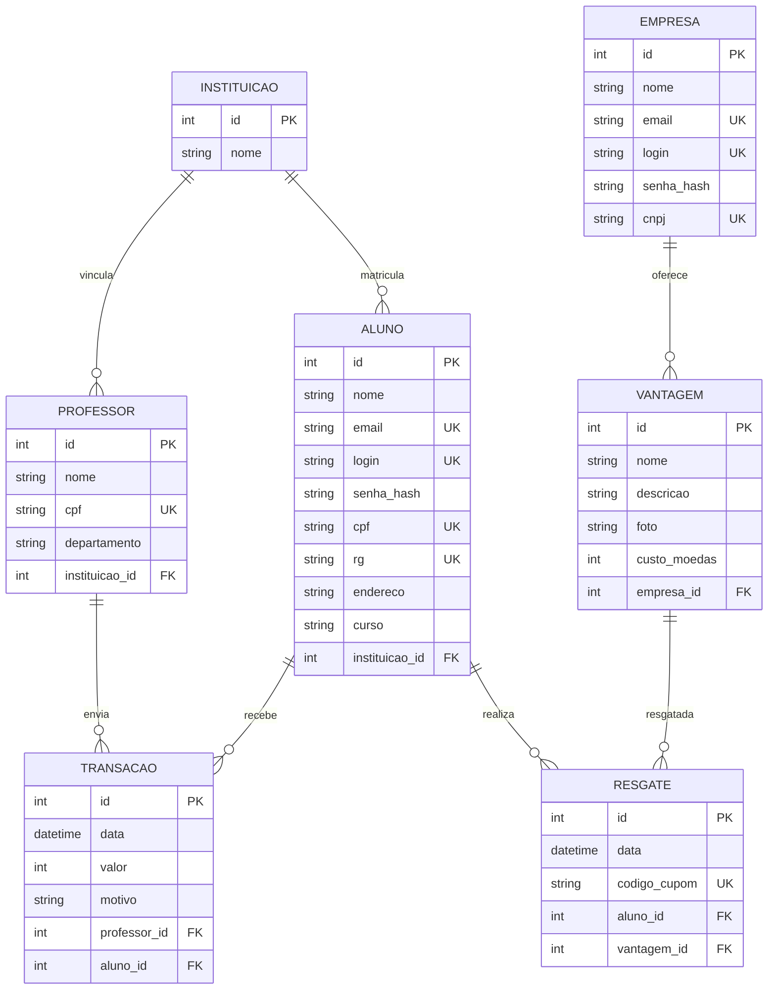

# Modelo entidade-relacionamento

Este modelo detalha as entidades e relações do sistema. A implementação do Lab 4.2 persiste as tabelas `instituicoes`, `alunos` e `empresas`, necessárias aos cadastros solicitados; as demais entidades documentam a evolução prevista para as próximas funcionalidades.

`UK` indica valor único e `FK` indica chave estrangeira. O diagrama visual inicial continua em [DiagramaER.png](./DiagramaER.png).
